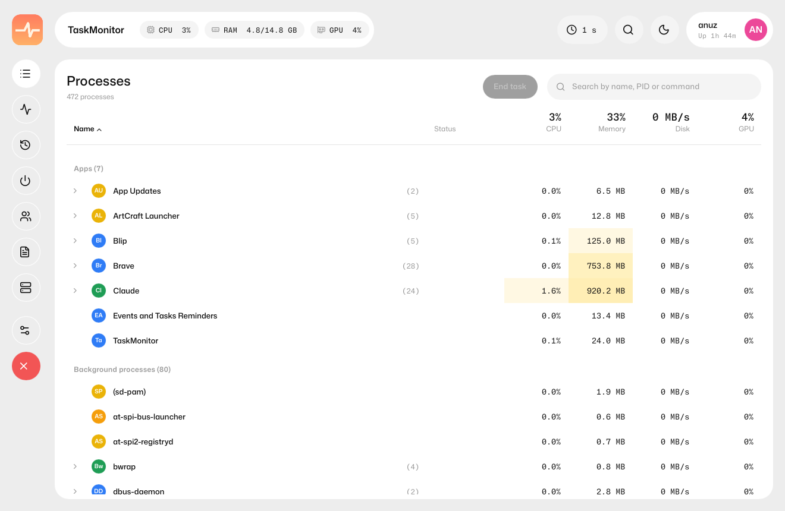
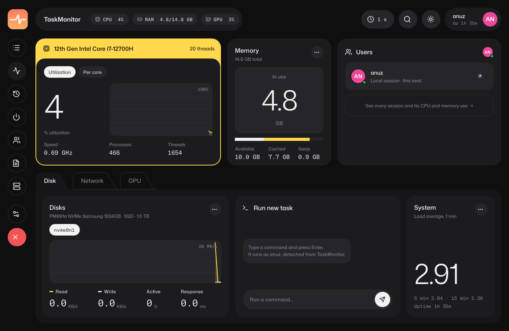
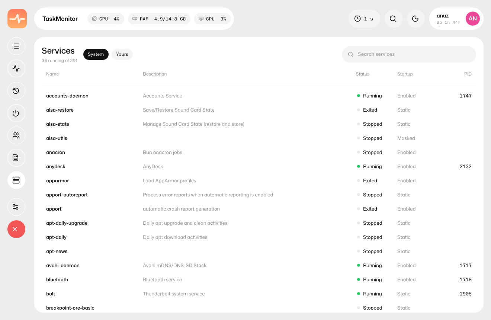
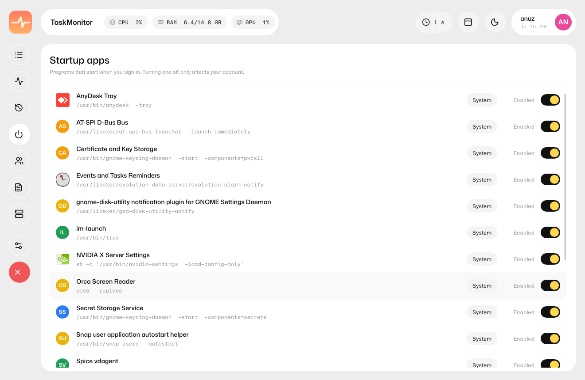
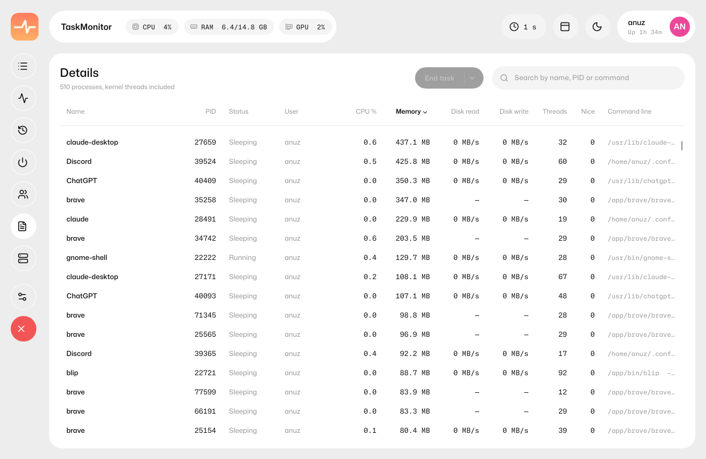
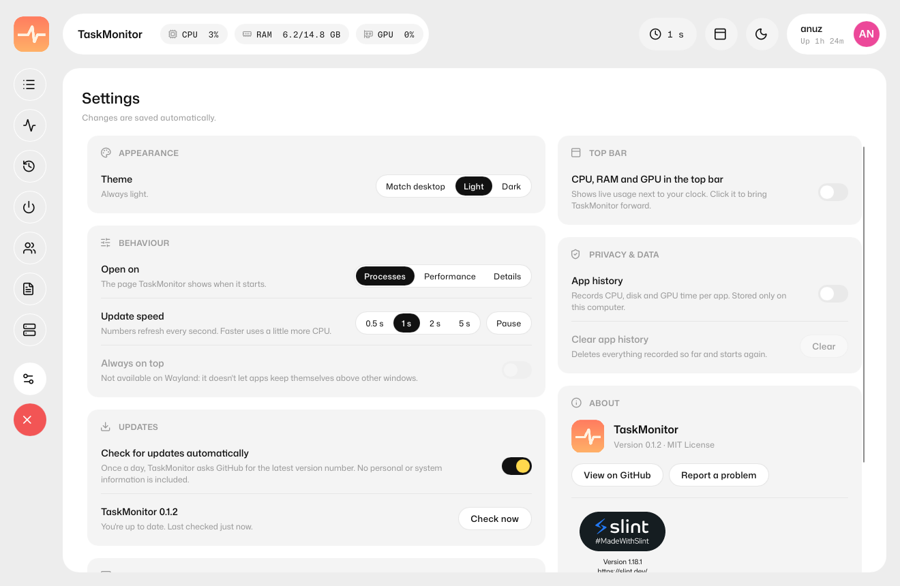

<p align="center">
  
</p>

<h1 align="center">TaskMonitor</h1>

<p align="center">A modern, lightweight task manager for Linux: everything Windows Task Manager does, in a clean card-based UI.</p>

<p align="center">
  <a href="https://discord.gg/NpS9WmSW23"></a>
  <a href="https://ko-fi.com/anujdhakal"></a>
</p>



| Performance | Dark theme |
|---|---|
|  |  |
| **Services** | **Startup apps** |
|  |  |
| **Details** | **Settings** |
|  |  |

## Features

- **Processes**: apps (detected from their desktop entries), background and system processes, grouped and expandable, with CPU, memory, disk and GPU use, heat-map cells, sorting and search.
- **Performance**: live CPU (total and per thread), memory, every disk and network adapter, and GPUs (Intel and AMD through the kernel, NVIDIA through NVML).
- **Process actions**: the **End task** split button keeps SIGTERM (15) as its main action. Its dropdown offers End task (SIGTERM, 15), Kill process (SIGKILL, 9, with confirmation), Suspend (SIGSTOP), and Resume (SIGCONT) on both Processes and Details. Right-click for those actions plus End process tree, Efficiency mode, priority, CPU affinity, Open file location, Properties, and Run new task. Actions on other users' processes ask for your password through polkit.
- **Details**: every process, kernel threads included, with PID, user, disk read and write, threads, nice value and command line.
- **Disk activity** on the Performance page: the processes reading and writing the most right now.
- **Properties** for any process, with a copy button on every value and Copy all.
- **Services**: system and user systemd services; start, stop, restart, enable and disable.
- **Startup apps**: switch autostart entries on and off.
- **Users**: signed-in sessions with per-user CPU and memory; lock or sign out.
- **App history** (opt-in): CPU, disk and GPU time per app, kept only on your computer.
- **Top-bar stats**: one click puts live CPU, RAM and GPU use in your desktop's top bar (system tray). On Ubuntu/GNOME the numbers show next to the icon; on KDE they show when you hover it.
- **App icons** from your icon theme, with initials for processes that have none.
- **Update checker**: once a day (or on demand in Settings) TaskMonitor asks GitHub whether a newer version exists and shows an "Update" pill in the top bar if so. It never installs anything by itself, and it can be turned off.
- Light and dark themes, sidebar icon tooltips, adjustable refresh rate, keyboard shortcuts (Ctrl+1–7 for pages, Delete ends the selected task, Esc closes dialogs).

TaskMonitor is written in Rust with [Slint](https://slint.dev). It uses about 1–2% of one CPU core and around 35 MB of memory, and it doesn't wake a sleeping laptop GPU.

## Install

Download a package from the [Releases](https://github.com/anuzdhk/linux-taskmanager/releases) page:

| Distro | File | Install |
|---|---|---|
| Any | `TaskMonitor-<version>-x86_64.AppImage` | `chmod +x TaskMonitor-*.AppImage`, then run it |
| Ubuntu, Debian, Mint, Pop!_OS | `taskmonitor_<version>-1_amd64.deb` | `sudo apt install ./taskmonitor_*.deb` |
| Fedora, RHEL, openSUSE | `taskmonitor-<version>-1.x86_64.rpm` | `sudo dnf install ./taskmonitor-*.rpm` |
| Arch, Manjaro, EndeavourOS | [`packaging/aur/PKGBUILD`](packaging/aur/PKGBUILD) | `makepkg -si` |
| Anything else | `taskmonitor-<version>-x86_64.tar.gz` | unpack, then `sudo ./install.sh` |

The packages run on any x86_64 distro from 2018 onwards (glibc 2.28 or newer). The Services and Users pages need systemd. Admin actions need polkit, and they aren't available in the AppImage.

## Build from source

You need Rust (via [rustup](https://rustup.rs)) and, on Debian/Ubuntu:

```sh
sudo apt install build-essential pkg-config libfontconfig1-dev libxkbcommon-dev
```

```sh
cargo run --release -p taskmonitor
```

Build every package into `dist/` (also needs `zig`, `squashfs-tools`, `cargo install cargo-zigbuild cargo-deb cargo-generate-rpm`):

```sh
./packaging/build-all.sh
```

## Project layout

| Path | What's there |
|---|---|
| `crates/core` | System data: `/proc` and `/sys` parsers, process, GPU, services, startup and session sources. No UI code. |
| `crates/app` | The Slint UI (`ui/`) and the glue that feeds it (`src/`). |
| `crates/helper` | The small root helper that `pkexec` runs for actions on processes you don't own. |
| `packaging` | Desktop entry, icons, polkit policy, AppStream metadata, build scripts, AUR recipe. |
| `IMPLEMENTATION_PLAN.md` | Design decisions, milestones and measurements. |

## Credits

- UI toolkit: [Slint](https://slint.dev)
- Font: [Mona Sans](https://github.com/github/mona-sans) (SIL Open Font License)
- Icons: [Lucide](https://lucide.dev) (ISC License)

## Support the project

TaskMonitor is free and open source. If it's useful to you, you can [buy me a coffee on Ko-fi](https://ko-fi.com/anujdhakal). See [DONATE.md](DONATE.md) for other ways to help.

## License

TaskMonitor is released under the [MIT License](LICENSE).

It is built with [Slint](https://slint.dev), used under the [Slint Royalty-free Desktop, Mobile, and Web Applications License](https://slint.dev/terms-and-conditions#royalty-free), which asks for attribution: the app shows Slint's "About Slint" panel in Settings. Mona Sans is under the SIL Open Font License and Lucide icons under the ISC License; both licence texts are installed with every package.
